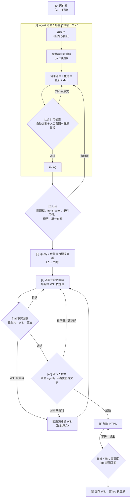

# LLM Wiki × 教學 HTML 簡報：大量傷病患與檢傷分類

依 [Karpathy 的 LLM Wiki 模式](https://gist.github.com/karpathy/442a6bf555914893e9891c11519de94f)，把 5 篇來源「編譯」成互相連結的 Markdown Wiki，再只用這個 Wiki 製作一份給**完全沒有醫療背景的同學**、約 15 分鐘的教學 HTML 簡報。

- 🎞️ **簡報**：[`slides/index.html`](slides/index.html)（下載後直接用瀏覽器開；←→ 換頁、N 講者備註、A 練習答案、F 全螢幕）
- 📚 **Wiki 入口**：[`wiki/index.md`](wiki/index.md)
- 📝 **完整過程紀錄**：[`wiki/log.md`](wiki/log.md)（每次檢查沒過、被迫重寫都有記）
- ⚙️ **規則（schema）**：[`AGENTS.md`](AGENTS.md)

作者：hcc（臺北醫學大學 傷害防治學研究所）｜協作：Claude

---

## 步驟一：建立 LLM Wiki

### 三層架構
| 層 | 位置 | 規則 |
|---|---|---|
| 原始來源 | `raw/` | 唯讀，5 篇 |
| Wiki | `wiki/` | LLM 撰寫維護：5 個來源頁、12 個概念頁、2 個比較頁，加上 `index.md`、`log.md` |
| Schema | `AGENTS.md` | 人與 LLM 共同演進（本次執行中新增了 10 條以上規則） |

### 來源（ingest 順序：S05 → S01 → S03 → S02 → S04）
| ID | 來源 | 在 Wiki 的角色 |
|---|---|---|
| S05 | 教育部防災教育研習：大量傷患處置與檢傷分類 | 中文、白話、台灣用語的基礎 |
| S01 | StatPearls：EMS Mass Casualty Triage（存檔版） | START 定義與起源 |
| S03 | Bazyar 等 2019：全球檢傷系統綜述 | 20 種系統全景、比較 |
| S02 | Bazyar 等 2022：檢傷系統準確度系統性回顧 | 「檢傷準不準」 |
| S04 | Alruqi 等 2023：MCI 到院前時間延遲因素 | 延誤因素、台灣案例 |

### 「先討論、後生成」
每篇 ingest 前，先在對話中列出重點、數字、與既有頁面的關係，以及發現的來源品質問題，**經使用者確認後才寫入**。S05 與 S01 逐篇確認；之後使用者授權「採用 AI 建議值」，改為事前授權，但每篇的決策仍記錄在 log。

### Wiki 的幾個實質發現（不是摘要，是交叉比對的結果）
- **START 開發年份衝突**：S01 寫 1983，S03 寫 1980 → 並列，簡報寫「1980 年代初」
- **「逆向檢傷」一詞兩義**：S05 指雷擊、低體溫者雖黑仍優先救；S03 指輕傷者優先 → 簡報不用此詞
- **S02 摘要與內文矛盾**：摘要稱各系統「都低於 90%」，內文數據卻有多項超過 90% → 只用內文
- **SALT 救命處置**：S02 寫「chest compression」，S01、S03 寫減壓 → 並列不裁決

---

## 步驟二：教學 HTML 簡報

14 張，三個學習目標：
1. 大量傷病患時，「先救誰」為什麼跟平常不一樣？
2. 紅黃綠黑代表什麼？START 怎麼分？
3. 為什麼做了檢傷，傷患還是可能被延誤？（台灣 2015 年彩色粉塵爆炸案例）

每張右下角標註來源；每一點在 [`slides/content.md`](slides/content.md) 都標了依據的 Wiki 頁，Wiki 頁再標到來源頁碼——**投影片 → Wiki → 原文**三層可追溯。

---

## 步驟三：Loop / Graph 設計



### 哪些步驟會重複執行？
| 迴圈 | 次數（本次） |
|---|---|
| [1] Ingest（讀→討論→寫→檢查） | 5 篇各一次，另有 1 次補正 |
| [1a] 引用檢查失敗 → 重寫 | 5 篇都有觸發 |
| [4] ↔ [4a] ↔ [4b] | 內容稿 v1 → v2 → v3，外行人檢查 2 輪 |
| [4a]／[4b] → 回補 Wiki | 2 次（共 4 項依據） |
| [5] ↔ [5a]／[5b] | 2 輪 |

### 哪些地方需要檢查或重新生成？
- **[1a] 引用檢查**：每條敘述對回原文。自動段（`tools/check_citations.py`）比對中文字詞或英文數字與術語；人工段負責看圖、確認歸屬
- **[2] Lint**（`tools/lint.py`）：結構與規則違反
- **[4a] 事實回溯**（`tools/check_slides.py`）：投影片每點 → Wiki 頁，列出 Wiki 找不到的數字與新詞
- **[4b] 外行人檢查**：另開一個 agent，**不給 Wiki、不給來源**，只給投影片文字，要它扮演無醫療背景同學，列出術語、跳步、誤解，並實際做練習題
- **[5a]／[5b]**：HTML 與內容稿逐點比對、逐頁截圖看版面

### 為什麼這樣設計？
1. **人工把關只放在需要判斷的地方**：選來源、強調什麼、教學目標。其他交給迴圈
2. **檢查貼近錯誤發生處**：引用在 ingest 當下就查，錯誤才不會擴散到多頁 Wiki 和多張投影片
3. **[4a] 和 [4b] 抓的是兩種錯**：[4a] 檢查「有沒有寫錯」，[4b] 檢查「寫對了但看不懂、會誤解」。本次 [4b] 第一輪找到的三大問題，[4a] 全部沒抓到，因為每句話都有來源
4. **寫的人不能自己驗收**：外行人檢查交給沒看過 Wiki 的 agent，才不會「我覺得很清楚」
5. **簡報缺資料時回 Wiki 補，而不是在簡報裡補**：保持「投影片 → Wiki → 原文」可追溯

---

## 步驟四：反思（數據來自 `wiki/log.md`）

### 哪一個節點最常出錯？
**會「改寫文字」的節點**：[1] 寫 Wiki 頁，以及 [4] 寫投影片。兩者犯的是同一型錯誤：**轉述時加料**。

| 錯誤型態 | 次數 | 例子 | 抓到它的節點 |
|---|---|---|---|
| 轉述時加了原文沒有的強調、限定或概括 | 7 | 「才」「只有」「多數」「至少」「派對」「瓦斯」「時間越長死亡率越高」 | [1a] 人工、[4a] |
| 讀圖表失真 | 2 | S05 p.44 禁止／打勾圖示、S03 表 7 少一步 | [1a] 看圖 |
| 歸屬錯誤 | 2 | S03 寫 MASS 的內容被算給 SALT；把轉引當成作者的建議 | [1a] 人工 |
| 背景知識混入 | 3 | CRT 解釋、「學校對象」推論、「八仙」 | [1a]、[4a] |
| 外行人會誤解（內容正確） | 3 大＋2 小 | 「先救有機會活的」被讀成綠色先救、流程邏輯錯誤、聽眾角色斷掉 | [4b] |
| **檢查器自己的錯** | 7 | 整段引用被跳過、跨語言失效、同頁數字歸屬、**把 LLM 補充當依據**、**截圖 14 張都是封面卻回報全過** | 人工看結果 |

單次密度最高的是 **[4] 內容稿 v1**：47 點中 [4a] 抓到 5 個事實錯誤（另有 1 個檢查器盲點），[4b] 再抓到 3 個理解問題。

### 發現問題後，把檢查往前移到了哪一個步驟？
1. **讀圖檢查移到 ingest 當下**（S05 之後，規則 8）：S05 p.44 的圖示錯誤讓我們把「圖表必看圖」寫進 [1a]，所以後來 S03 表 7 的錯誤在 ingest 時就抓到了，不是等到做簡報才發現
2. **歸屬複核移進 ingest**（S02 之後，規則 10）：同一頁講多個系統時，確認數字和說法「屬於誰」，而不只是「有出現在這頁」
3. **「LLM 補充不得作為依據」移進檢查器**：[4a] 發現「派對」能通過，是因為 Wiki 裡標了「未驗證」的那行也被當成依據
4. **下一次：外行人的問題移到 [3] 擬大綱時**：本次 [4b] 逼出的 Wiki 缺口（打開呼吸道的方法、需要事前訓練、「為什麼沒照檢傷後送」原因不明），都要回頭補 Wiki。如果在大綱階段先問「外行人會問什麼」，就能在寫內容稿之前補齊

### 有沒有因此修改 workflow／graph？為什麼？
有，以下都已寫進 `AGENTS.md`：
- **[1a] 由一段改為三段**：自動比對＋人工看圖＋歸屬複核。原因是自動比對只能確認詞彙「存在」，抓不到語意和歸屬錯誤
- **新增「[4] → 回補 Wiki」這條邊**：簡報層發現的缺口要回到來源補，維持可追溯
- **[4a] ↔ [4b] 改成迴圈**：依外行人回饋改寫時會寫出新句子，新句子又可能加料，所以每輪都要重跑 [4a]
- **新增 [5a] HTML 忠實度檢查**：從內容稿排成網頁時也會改字，本次就把 START 全名裡的「and」改成了「And」
- **自動檢查必須證明自己看對東西**：版面檢查第一版回報「14 頁全過」，實際上檢查了 14 次封面

**最大的收穫**：規則寫進 AGENTS.md，不等於會被遵守（「逐行引用」訂了之後我自己又違反一次，是 lint 抓到的）；檢查器回報「通過」，也不等於真的沒問題。所以這個 graph 裡，**每一個自動檢查的後面都接著一個人工確認**。

---

## 檔案結構
```
raw/        原始來源（唯讀）
wiki/       index.md、log.md、sources/、concepts/、comparisons/
slides/     outline.md（大綱）、content.md（內容稿 v3）、index.html（簡報）
tools/      check_citations.py、lint.py、check_slides.py、check_html_fidelity.py、check_layout.py
AGENTS.md   規則；CLAUDE.md 指向它
```
